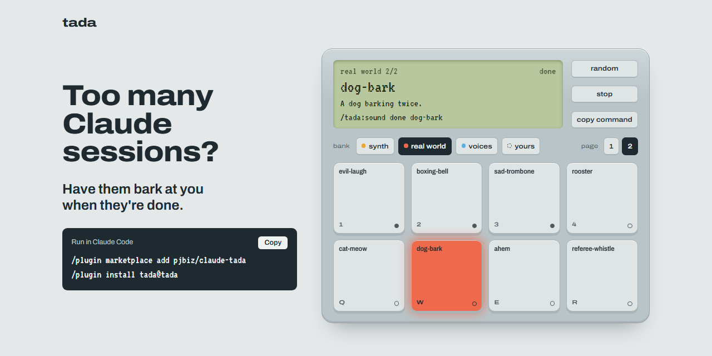

# tada

[](https://tzamaranth.github.io/claude-tada/)

**Too many Claude sessions? Have them bark at you when they're done.**

tada is a Claude Code plugin. The moment any session finishes, it plays a sound: a
bark, a ka-ching, a ta-da, 65 to pick from or your own. When a session stops to ask for your
permission, you hear a different one, so it doesn't sit blocked for twenty minutes
while you're in another window. No more cycling through terminals to see which
session is still thinking.

[**Play all 65 sounds**](https://tzamaranth.github.io/claude-tada/) &nbsp;·&nbsp;
[Install](#install) &nbsp;·&nbsp;
[Download the zip](https://github.com/TZamaranth/claude-tada/releases/latest)

[](https://github.com/TZamaranth/claude-tada/releases/latest)
[](LICENSE)
[](sounds/CREDITS.md)


## Install

In Claude Code:

```
/plugin marketplace add TZamaranth/claude-tada
/plugin install tada@tada
```

Run `/reload-plugins` or restart Claude Code, then send any prompt. When Claude
finishes, you'll hear it. Install it once and every session uses it, in every
terminal and project. Sessions that were already open pick it up after
`/reload-plugins`.

<details>
<summary>Other ways to install</summary>

**From a terminal:**

```bash
claude plugin marketplace add TZamaranth/claude-tada
claude plugin install tada@tada
```

**From the download:** get `tada-v*.zip` from the
[latest release](https://github.com/TZamaranth/claude-tada/releases/latest), unzip it
somewhere permanent (you get a `tada` folder), then in Claude Code:

```
/plugin marketplace add ~/tada
/plugin install tada@tada
```

On Windows, use the full path: `/plugin marketplace add C:\Users\you\tada`.

**For one session only:** `claude --plugin-dir path/to/tada-v1.3.2.zip`.

</details>

## Pick your sounds

Choose two that sound nothing alike. Done means a session has something for you to
review; needs input means one is blocked until you answer. With different sounds,
you know which it is before you look.

Ask for one by name, or describe what you want and let Claude pick:

```
/tada:sound done dog-bark                 when a session finishes
/tada:sound needs-input knock             when one needs your permission
/tada:sound done random                   a different one every time
/tada:sound something goofy for done      Claude reads the list and chooses
/tada:sound play cow                      just preview
```

There are 65 to choose from, and every one is free to use (CC0).

| Group                 | A few of them                                                          |
| --------------------- | ---------------------------------------------------------------------- |
| **Chimes and synths** | tada, coin, level-up, fanfare, marimba, kalimba, doorbell, kazoo, owl  |
| **Real-world sounds** | ka-ching, toilet-flush, air-horn, sad-trombone, cow, gong, rubber-duck |
| **Announcer voices**  | "Mission completed.", "Congratulations!", "You win!", "Hurry up!"      |

<details>
<summary>All 65 sound names</summary>

**Chimes and synths (31):** tada (default for done), coin, level-up, power-up,
fanfare, marimba, kalimba, harp, ding, doorbell, wind-chimes, sparkle, success,
champagne, drumroll, cuckoo, bird, boing, slide-whistle, kazoo, bubbles, robot,
hm (default for needs-input), knock, sonar, blip, huh, glass-tap, triple-beep,
tick-tock, owl

**Real-world sounds (26):** ka-ching, toilet-flush, crowd-cheer, party-horn,
microwave, jackpot, gong, rubber-duck, cow, duck-quack, typewriter-ding, burp, fart,
air-horn, woohoo, magic-wand, evil-laugh, boxing-bell, sad-trombone, rooster,
cat-meow, dog-bark, ahem, referee-whistle, phone-ring, bicycle-bell

**Voices (8):** voice-congratulations, voice-mission-complete,
voice-objective-achieved, voice-you-win, voice-new-highscore, voice-level-up,
voice-hurry-up, voice-ready

</details>

Any sound works for either event. Your choices live in `~/.claude/tada.conf`,
which you can also edit by hand:

```
done=kazoo
needs-input=owl
```

## Bring your own sounds

Want your own dog, your kid yelling "all done!", or your team's victory chant? tada
doesn't ship those, but it plays any clip you get yourself, just like a built-in.

1. **Get a clip.** Record one (a phone voice memo works), or download one you have
   the right to use, such as a CC0 sound from [Freesound](https://freesound.org) or a
   free effect from [Pixabay](https://pixabay.com/sound-effects/). An mp3, wav or
   m4a of a second or two works best.
2. **Add it.** tada copies it into `~/.claude/sounds/` under a name:

   ```
   /tada:sound add ~/Downloads/bark.mp3
   ```

   Or skip the path and tell Claude "add the bark I just downloaded". It looks at the
   newest audio files in your Downloads folder.

3. **Pick it.** `/tada:sound done bark`

Your clips show up in `/tada:sound list` and in `random`, and plugin updates never
touch them. `/tada:sound remove bark` deletes one. tada never downloads audio itself,
and clips you add aren't covered by tada's licence, so use audio you have the right to.

You can also drop a file named after the event, `~/.claude/sounds/done.mp3` or
`needs-input.mp3`, and it plays for that event whatever else you've picked. On
Windows, `~/.claude/` is `C:\Users\<you>\.claude\`.

## Questions

**Does it work with several sessions at once?** Yes, that's what it's for. Every
session plays its own sounds, whatever terminal or project it's in. The sound
doesn't say which session it came from, so glance at your windows: the one that
called is the one waiting at its prompt.

**Does it slow Claude down?** No. The sound plays in the background, and Claude
never waits for it.

**How often does it play?** Once when Claude finishes its reply, not after every
step or tool call. The permission sound plays each time Claude asks to run
something.

**Can I silence it for a while?** `/tada:sound done off` and
`/tada:sound needs-input off`. Turn it back on with `default` or any sound name.

**Can I use it without Claude?** Yes, the same tool runs in a terminal:
`bash <plugin folder>/scripts/tada.sh list | show | play <name> | set <event> <name> | add <file> [name]`.

**Does it send anything anywhere?** No. tada runs only its own scripts and your
system's audio player. It reads and writes `~/.claude/tada.conf` and
`~/.claude/sounds/`, collects nothing, and makes no network requests.

**Something's wrong. Where do I report it?**
[Open an issue](https://github.com/TZamaranth/claude-tada/issues) on GitHub.

## Requirements

| OS      | Needs                                                                                                |
| ------- | ---------------------------------------------------------------------------------------------------- |
| macOS   | Nothing extra (`afplay` is built in)                                                                 |
| Windows | [Git for Windows](https://git-scm.com/downloads/win) (Git Bash), which Claude Code recommends anyway |
| Linux   | One of `paplay`, `pw-play`, `aplay` or `ffplay`. Without a player you get a terminal bell.           |

On Windows without Git Bash, Claude Code runs hooks through PowerShell and tada
stays silent. It never blocks or breaks your session.

On Linux, clips you add as mp3 or m4a play through `paplay`, `pw-play` or `ffplay`
(`aplay` only handles WAV).

## Update or remove

```bash
claude plugin update tada@tada
claude plugin uninstall tada@tada
```

Or use `/plugin` in Claude Code and pick tada under **Installed**. Uninstalling
leaves `~/.claude/tada.conf` and your clips in `~/.claude/sounds/` in place; delete
them by hand if you want them gone.

## How it works

`hooks/hooks.json` registers two hooks:

- `Stop` runs `scripts/play-sound.sh done`
- `Notification` (matcher `permission_prompt`) runs `scripts/play-sound.sh needs-input`

Both run in the background (`async`). `play-sound.sh` picks the file in this order:
your own file in `~/.claude/sounds/`, then your choice in `~/.claude/tada.conf`, then
the default. `play-file.sh` plays it with your OS's player. On Windows it hands off
to `scripts/play-sound.ps1`, which uses the built-in Windows media player.

## Where the sounds come from

Every bundled sound is public domain (CC0), so you can use them anywhere.

- **Chimes and synths** are generated by `tools/make-sounds.py` from oscillators,
  filtered noise and a plucked-string model, using only the Python standard library.
- **Real-world sounds** are recordings their authors released as CC0 on
  [Freesound](https://freesound.org).
- **Voices** come from Kenney's CC0 [Voiceover Pack](https://kenney.nl/assets/voiceover-pack).

[sounds/CREDITS.md](sounds/CREDITS.md) credits every recording to its author.
`tools/import-recordings.py` is a maintainer's tool for rebuilding these files; it
downloads the CC0 sources, and the plugin itself never runs it.

### Add a sound

Pull requests are welcome. Add a CC0 recording to `sounds/recordings.json` (the
importer refuses anything else) or a synthesized one to `tools/make-sounds.py`,
then rebuild:

```bash
pip install -r tools/requirements.txt
python tools/import-recordings.py   # downloads the CC0 sources, writes the recorded .wav files
python tools/make-sounds.py         # synthesizes the rest, writes catalog.tsv and CREDITS.md
python tools/make-site.py           # rebuilds the home page (index.html)
```

## License

Code: [MIT](LICENSE). Bundled sounds: CC0. Clips you add yourself: whatever their
owners allow.

tada is an independent project, not affiliated with or endorsed by Anthropic. Claude
and Claude Code are trademarks of Anthropic.
